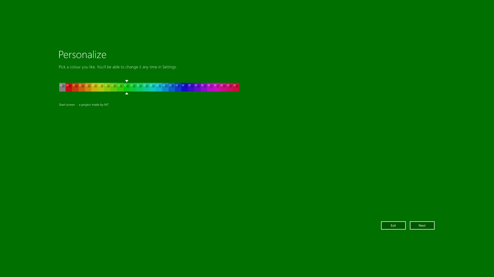
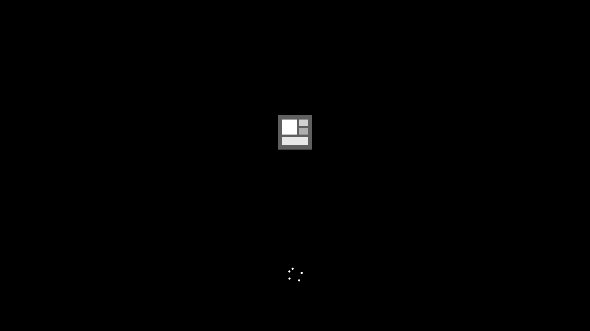
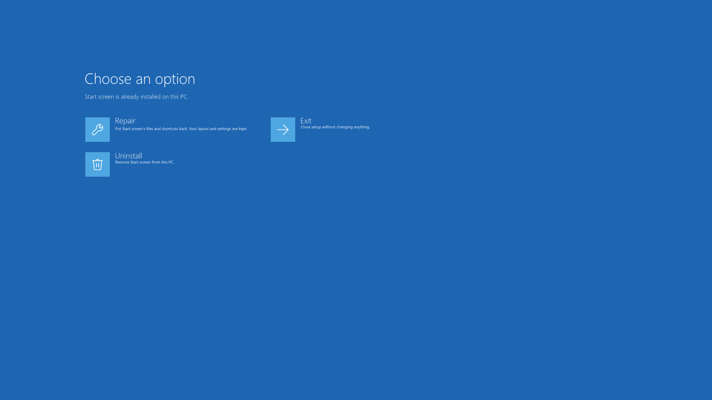

# Start screen

A full-screen **Windows 8.1 style Start screen** for Windows 10 and 11, rebuilt from scratch as a real, working app.

Press the Windows key (or click the taskbar Start button) and instead of the Start menu you get live-sized tiles, groups, semantic zoom and an All apps view, the way the 8.1 Start screen worked. *A project made by MT.*

> **Not affiliated with Microsoft.** "Windows" is a trademark of Microsoft Corporation. This is an independent project: no Microsoft code or artwork is included, and the backgrounds, icon and installer artwork are original.

## Features

**Start screen**
- Tiles in four sizes, with smooth animated resizing, and drag-and-drop to rearrange or start a new group
- Groups with names, and semantic zoom (Ctrl + scroll) to arrange them
- All apps view, search that works as you type, and smooth horizontal scrolling, including trackpad side-swipes
- Right-click for an app bar at the bottom: pin or unpin, resize, open file location, run as administrator, uninstall
- Settings charm with quick buttons for volume, brightness, network and power, plus Tiles and Help pages that slide in from the side
- Personalize: a continuous colour slider that fades, and 19 original background patterns
- Scales to any screen size (laid out for 1920x1080 and fitted to the real screen)
- Uninstall option in Settings > Help, with a confirm screen and a fade to black

**Installer**
- Borderless full-screen setup in the style of Windows 8.1 setup: it starts by picking a colour, then a background
- A Windows-style start-up screen plays when you open it
- Installs for your account only: no administrator rights needed
- Run it again and it offers **Repair** or **Uninstall** on a screen modelled on the Windows "Choose an option" screen

## Screenshots

| Setup: pick a colour | Start-up screen | Modify (repair or uninstall) |
| --- | --- | --- |
|  |  |  |

## Install

Open **[StartScreenSetup.exe](StartScreenSetup.exe)** in the file list above, click the download button, and double-click it. That is the whole install: it needs no administrator rights, and running it again later offers Repair or Uninstall.

## Build from source

Needs only what ships with Windows: the .NET Framework compiler, no SDK or Visual Studio.

```powershell
.\build.ps1                        # builds StartScreen.exe
.\Installer\build-installer.ps1    # rebuilds the app, then builds StartScreenSetup.exe with it embedded
.\make-icon.ps1                    # regenerates StartScreen.ico (only if you change the icon)
```

| File | What it is |
| --- | --- |
| `StartScreen.cs` | the whole app (WPF) |
| `Installer/Installer.cs` | the setup / repair / uninstall program (WinForms, drawn by hand) |
| `make-icon.ps1` | draws the icon: the tile layout on a flat gray, pixel-aligned at every size |

## How it works, briefly

- Lists installed apps from the shell's AppsFolder and launches them through it
- A low-level keyboard hook opens it on a lone Windows key press, and a low-level mouse hook does the same for a click on the taskbar Start button. Both can be switched off from the tray icon, and neither changes any Windows setting: quit the app and the normal Start menu is back
- Uninstalling an app runs that app's own uninstaller
- Settings and layout are saved to `%APPDATA%\StartScreen8`

## License

MIT, see [LICENSE](LICENSE).
